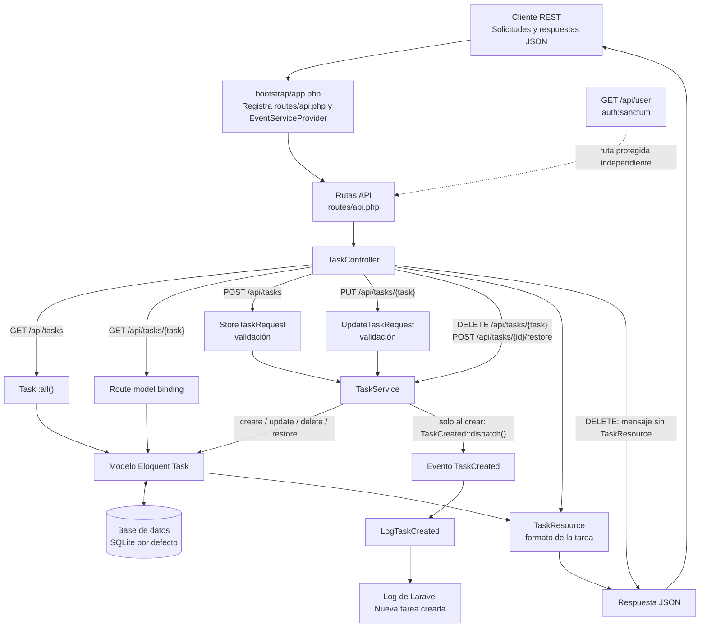

# Flujo de la arquitectura actual

La aplicación expone una API REST para administrar tareas. El siguiente diagrama refleja los flujos que están implementados actualmente:

## Resumen

- Las rutas API se registran desde `bootstrap/app.php` y conectan los endpoints de tareas con `TaskController`.
- Las solicitudes de creación y actualización se validan con sus respectivos Form Requests. El controlador consulta la lista directamente con `Task::all()`; las operaciones de creación, actualización, eliminación y restauración usan `TaskService`.
- `Task` persiste los datos mediante Eloquent. Usa soft deletes para eliminar y restaurar tareas.
- Al crear una tarea, `TaskService` despacha `TaskCreated`; `LogTaskCreated` registra sus datos en el log de Laravel.
- Las respuestas de tareas se formatean con `TaskResource`, excepto la respuesta de eliminación, que devuelve solamente un mensaje.
- La ruta `/api/user` está protegida con Sanctum y no forma parte del flujo de tareas.
